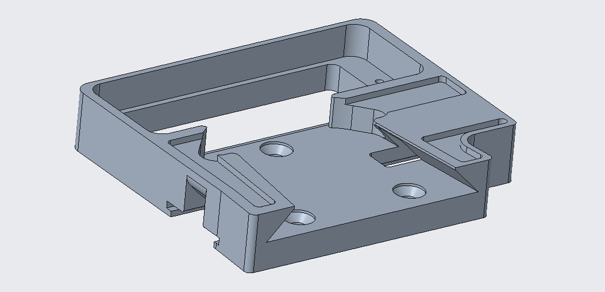
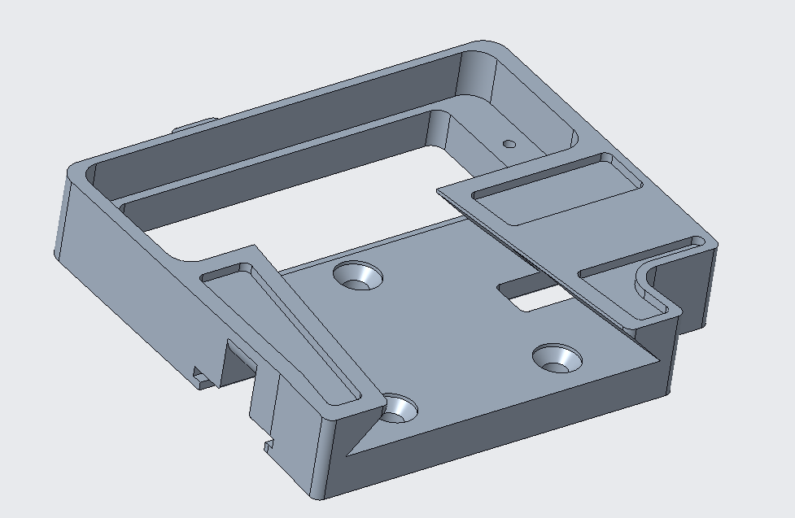

# sUPI Change Log

Small Universal Payload Interface

> **DISTRIBUTION STATEMENT A. APPROVED FOR PUBLIC RELEASE; DISTRIBUTION IS UNLIMITED.**

> This log covers the mechanical interface only. For electrical revision state, use
> the revision of each card's assembly, board and schematic numbers and the revision block on its
> fabrication drawing. The v3.3 electrical reference design is the KiCad source for one platform
> card and one payload card.

## sUPI 3.1

| Part | Change |
| --- | --- |
| All | First release in this change log. |

## sUPI 3.2

| Part | Change |
| --- | --- |
| `13122514` (V-Mount Base) | Changed to be machinable without custom dovetail cutter. |

<table>
<tr><td align="center"><strong>Old</strong></td><td align="center"><strong>New</strong></td></tr>
<tr>
<td></td>
<td></td>
</tr>
</table>

`13122514` before and after the v3.2 change.

## sUPI 3.3

This version makes the parts easier to machine and makes the fit better. The machining plan does
not need special tools. The parts that mate have less play between them. The electrical interface
did not change.

| Part | Change |
| --- | --- |
| `13122514` (V-Mount Base) | Offset taper faces to eliminate play between parts. |
| `13122514` (V-Mount Base) | Changed button cover slot to rounded interior to make it machinable. |
| `13122516` (Small Button Cover) | Rounded button cover to match `13122514` slot round. |
| `13122515` (Short Button) | Changed button geometry to make lower profile and eliminate bending. |
| `13122515` (Short Button) | Changed button interfaces to eliminate play between parts. |
| Payload and platform interfaces | Added version number engraving. |

Examine the engraved version number before you mate halves from different versions. Parts from
earlier versions have a looser fit. Earlier `13122515` buttons are taller, and they can bend.
