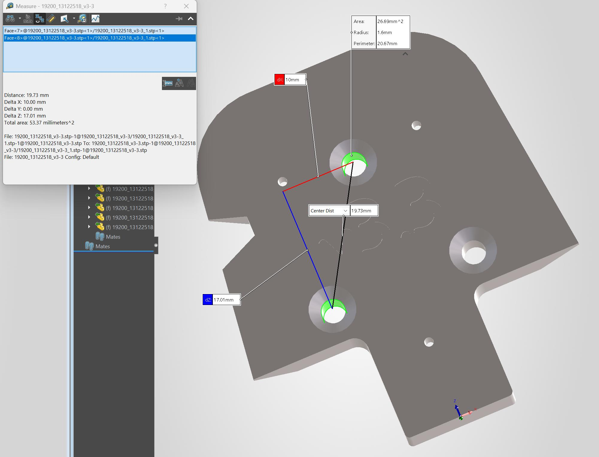
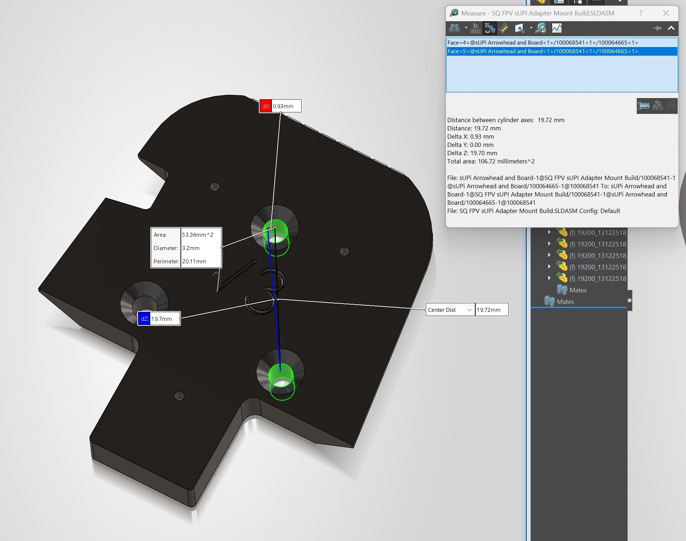

<!-- Title: V MOUNT 13122518 (v3.3): the model hole positions are different from 100064665 V3 -->

The hole positions in the v3.3 V MOUNT model (`19200_13122518_v3-3.stp`) are different from the V3 hole positions (`100064665_REV0.STEP`). This change is not in the Change Log. The screenshots show 19.72 mm and 19.73 mm because the Measure tool shows only 2 decimal places. The table values are from the hole axes in the two STEP files.

A and B are the two holes at .780 on the drawing. C is the hole at 1.449.

| Dimension | V3 | v3.3 | Difference |
|---|---|---|---|
| Hole C to end edge | 36.8000 mm | 36.8046 mm | +0.0046 mm |
| Holes A/B to hole C, along the part | 17.0000 mm | 17.0053 mm | +0.0053 mm |
| Holes A/B to hole C, center distance | 19.7231 mm | 19.7276 mm | +0.0046 mm |
| Part width (1.822 on the drawing) | 46.2734 mm | 46.2788 mm | +0.0054 mm |
| Corner radius at the hole C end | 12.000 mm | 10.668 mm | −1.332 mm |

### Why this is a problem

The difference is approximately 4% of the ±.005 in tolerance. Parts from both models are in tolerance. The problem is in the model geometry:

- **Mates:** CAD software solves mates without manufacturing tolerance. If an assembly attaches this part to a V3 hole pattern with concentric mates on 2 or more holes, the assembly becomes over-defined.
- **Product definition:** Drawing note 9 makes all model geometry BASIC. Shops use the STEP file to program the CNC machine. Any change to the model geometry changes the part.

### Cause

The v3.3 values are equal to the rounded inch dimensions on the drawing. Hole C is at 1.4490 in from the end edge, and the drawing shows 1.449. The v3.3 width is 1.8220 in, and the drawing shows 1.822. The V3 width is 1.82179 in. It is possible that a person made the v3.3 model in Creo from the rounded drawing values, not the metric model. If this is correct, other features can also have small errors.

The rounded values do not cause the corner radius change. This change is also not in the Change Log.

### Fix

Use mm values, or inch values with 6 decimal places. Do not use the rounded drawing values.

- [ ] In the 13122518 model, move holes A and B to 19.800 mm (0.779528 in) from the end edge.
- [ ] Move hole C to 36.800 mm (1.448819 in) from the end edge.
- [ ] Make sure that the distance between holes A and B is 20.000 mm.
- [ ] Compare all of the v3.3 model geometry with the V3 model geometry.
- [ ] Correct each difference that is not in the Change Log, or record it in the Change Log.
- [ ] Export a new STEP file.

### Check

- [ ] Set the Measure tool to 4 decimal places. Make sure that the distance from hole A to hole C is 19.7231 mm.
- [ ] Replace 100064665 with 13122518 in `SQ FPV sUPI Adapter Mount Build.SLDASM`. Make sure that the assembly has no mate errors.

### Screenshots

v3.3 (13122518): 19.73 mm

V3 (100064665): 19.72 mm
