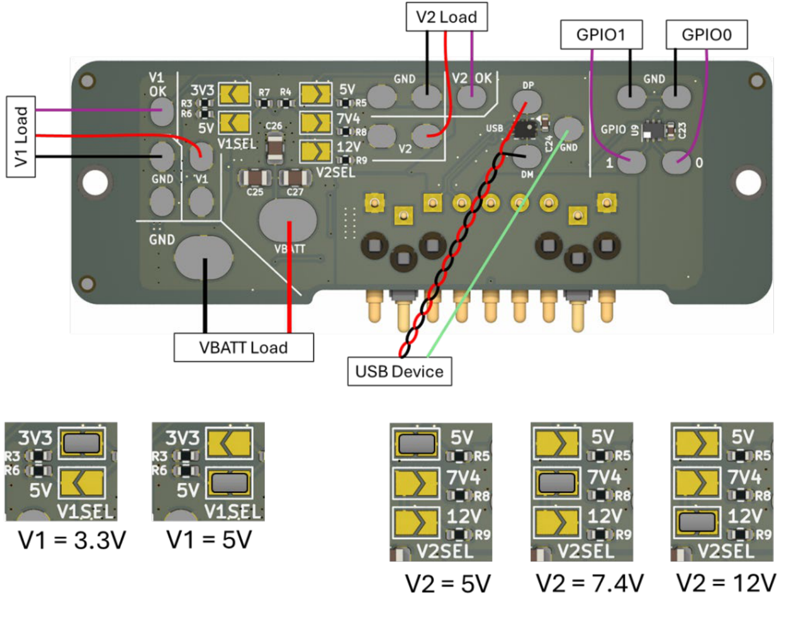
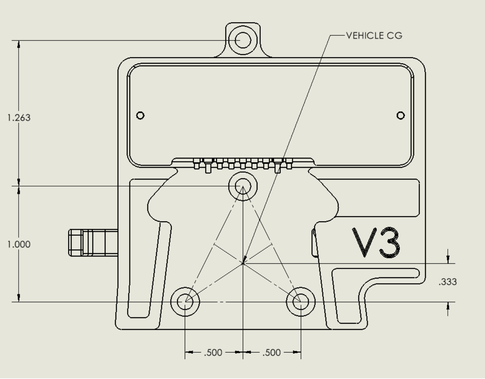

# Small Universal Payload Interface (sUPI): Payload Side Brief

**sUPI v3.3**

> **DISTRIBUTION STATEMENT A. APPROVED FOR PUBLIC RELEASE; DISTRIBUTION IS UNLIMITED.**

## Overview

sUPI is an interface that connects payloads to UxS platforms, for example drones. You can replace
one payload with a different payload. sUPI is a subset of the Picatinny Common Lethality Integration
Kit (CLIK) Design Standard. The interface board of the platform detects the payload and controls the
payload signals. The payload interface board supplies power to the payload. USB and GPIO signals go
through the physical and electrical interface.

## Electrical interface for the payload

The sUPI payload side board has solder pads for the wires to the payload. Figure 1 shows the wiring
diagram.

- Use 18 to 22 AWG wire for power (`VBATT`, `VBATT_RET`).
- Use 24 to 30 AWG wire for signals.

The payload board supplies regulated power. The `V1SEL` and `V2SEL` solder bridges set the
voltages.

| Signal | Range |
| --- | --- |
| `VBATT` | Platform battery, 13 to 25.2 VDC |
| `VBATT_RET` | Battery return |
| `V1` | Regulated power, 3.3 or 5 VDC |
| `V2` | Regulated power, 5, 7.4 or 12 VDC |
| `GPIO` | 3.3 V PWM, 50 Hz |
| `USB` | 0 to 3.3 VDC |

> **CAUTION:** Make sure that `DETECT` is enabled on the platform side before you connect the
> payload. If the platform side has `FORCE ON`, the power pins always have voltage, also when no
> payload is connected. Refer to the [platform brief](sUPI_Platform_Brief.md).

### Rail selection

You set `V1` and `V2` with solder bridges when you assemble the board. The voltages do not change
during operation.

> **CAUTION:** Make sure that the solder bridges agree with the voltages that the payload needs. Do
> this before you apply power for the first time.

| Selector | Options |
| --- | --- |
| `V1SEL` | `3V3` or `5V` |
| `V2SEL` | `5V`, `7V4` (7.4 V), or `12V` |

### Solder pads

The silkscreen on the payload board shows the names of the wiring pads: `VBATT`, `GND`, `V1`,
`V1 OK`, `V2`, `V2 OK`, `USB DP`, `USB DM`, `GPIO 0`, `GPIO 1`.

**Figure 1.** Payload side wiring diagram and rail selection. The lower panels show the correct
positions of the `V1SEL` and `V2SEL` solder bridges.

## Mechanical interface for the payload

Use 4X M3 × 0.5 mm, 8 mm long, black-oxide stainless steel Phillips flat-head screws to attach the
sUPI Payload Side to a payload. An example is McMaster PN 91698A304. Figure 2 shows the hole
pattern.

> **WARNING:** Align the platform CG and the payload CG when you install the two halves. If these
> CG points are not aligned, there can be critical failures during use.

Use one of these two methods to install the sUPI Payload Side on a payload:

- Drill and tap 4X holes into the payload, as Figure 2 shows. Put the holes where the sUPI Payload
  Side will be. On a UAV, align the vehicle CG with the point in Figure 2, as near as possible.
- Make an adapter. Put the sUPI Payload Side hole pattern on the adapter. Attach the adapter to an
  interface that is on the payload.

**Figure 2.** Payload side hole pattern, 4X M3, seen from the mounting face. The dimensions are in
inches. The `VEHICLE CG` callout shows the recommended center-of-gravity reference point. The two
smaller holes are M2 holes to attach the board. Do not use them to attach the payload side to the
host.

Refer to drawing `19200_13122514` for the dimensions and tolerances. The drawing controls the part.
