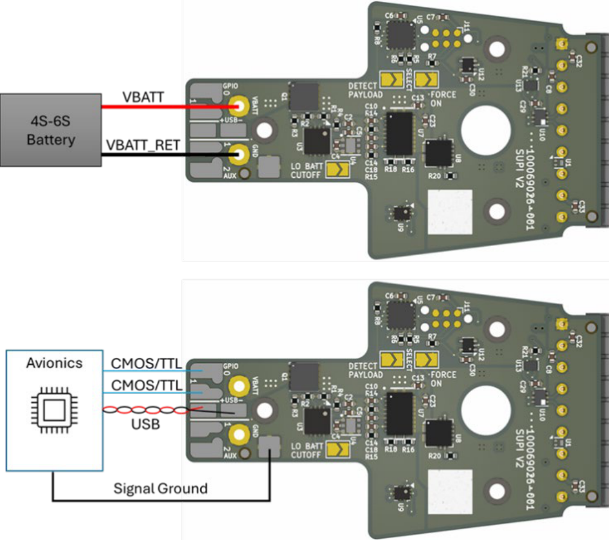
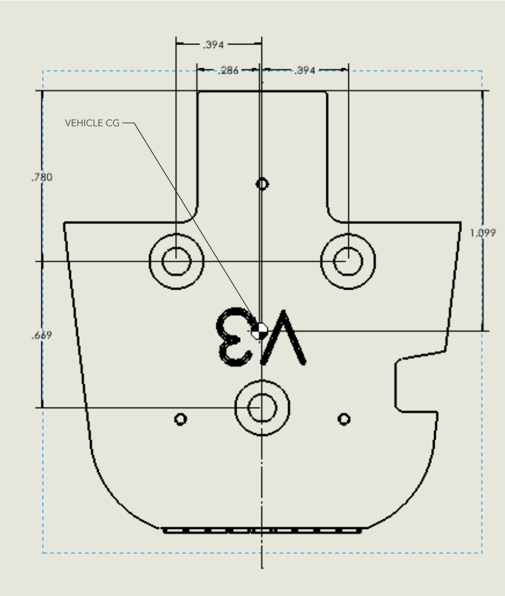

# Small Universal Payload Interface (sUPI): Platform Side Brief

**sUPI v3.3**

> **DISTRIBUTION STATEMENT A. APPROVED FOR PUBLIC RELEASE; DISTRIBUTION IS UNLIMITED.**

## Overview

sUPI is an interface that connects payloads to UxS platforms, for example drones. You can replace
one payload with a different payload. sUPI is a subset of the Picatinny Common Lethality Integration
Kit (CLIK) Design Standard. The interface board of the platform detects the payload and controls the
payload signals. The payload interface board supplies power to the payload. USB and GPIO signals go
through the physical and electrical interface.

## Electrical interface for the platform

The sUPI platform side board has solder pads for the wires to the platform avionics. Figure 1 shows
the wiring diagram.

- Use 18 to 22 AWG wire for power (`VBATT`, `VBATT_RET`).
- Use 24 to 30 AWG wire for signals.

The platform must supply these signals to the sUPI interface board:

| Signal | Range |
| --- | --- |
| `VBATT` | Platform battery, 13 to 25.2 VDC |
| `VBATT_RET` | Battery return |
| `GPIO` | 3.3 V PWM, 50 Hz |
| `USB` | 0 to 3.3 VDC |

The range of 13 to 25.2 VDC agrees with a 4S to 6S lithium-polymer battery pack.

### Solder pads and jumpers

The silkscreen on the platform board shows the names of the wiring pads and the configuration
jumpers:

- Wiring pads: `VBATT`, `GND`, `GPIO 0`, `GPIO 1`, `+USB−`, `AUX`
- Configuration jumpers: `DETECT PAYLOAD`, `SELECT`, `FORCE ON`, `LO BATT CUTOFF`

> **CAUTION:** Make sure that a solder blob enables `DETECT` before you install the platform side on
> a platform.

`DETECT` is the default configuration of the platform-side card. With `DETECT`, you can safely
connect a payload to a platform that has power ("hot plug"). `FORCE ON` overrides the detect gate.
With `FORCE ON`, the power pins always have voltage, also when no payload is connected.

**Figure 1.** Platform side wiring diagram. The battery connects to `VBATT` and `GND`. The avionics
connect to `GPIO`, `+USB−` and ground.

## Mechanical interface for the platform

Use 3X M3 × 0.5 mm, 8 mm long, black-oxide stainless steel Phillips flat-head screws to attach the
sUPI Platform Side to a platform. An example is McMaster PN 91698A304. Figure 2 shows the hole
pattern.

> **WARNING:** Align the platform CG and the payload CG when you install the two halves. If these
> CG points are not aligned, there can be critical failures.

Use one of these two methods to install the sUPI Platform Side:

- Drill and tap 3X holes into the platform, as Figure 2 shows. Put the holes where the sUPI
  Platform Side will be. Align the platform CG with the CG point in Figure 2, as near as possible.
- Make an adapter. Put the sUPI platform side hole pattern on the adapter. Attach the adapter to an
  interface that is on the platform.

**Figure 2.** Platform side hole pattern, 3X M3, seen from the mounting face. The dimensions are in
inches. The `VEHICLE CG` callout shows the center-of-gravity reference point. This point is on the
centerline, 1.099 in from the top edge. The three smaller holes are M1.6 holes to attach the board.
Do not use them to attach the platform side to the host.

Refer to drawing `19200_13122518` for the dimensions and tolerances. The drawing controls the part.
